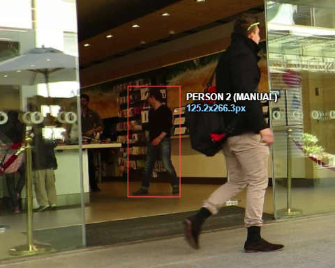

# Báo cáo cá nhân — HoVaTen-MSSV

Đổi tên file theo quy tắc `MSSV_HoTen.md`. Ví dụ: `20241234_NguyenVanAn.md`.

Đoạn video: MOT17-09, 150 frame (frame 1–150), nguồn MOTChallenge, giấy phép CC BY-NC-SA 3.0.

## 0. Thông tin học viên

- Họ tên: Bùi Công Đạt
- MSSV: 2A202603068
- Mã đề (A/B/C):09-B
- Email:datcongh43@gmail.com
- Link repository: https://github.com/BuiCongDat2905/K5-L2-Day5-2A202603068-BuiCongDat-MOTTracking.git
- Giờ bắt đầu:16h(13/11)
- Giờ kết thúc:19h30(13/11)

## 1. Xem trước đoạn video (CP0)

Ghi **trước khi vẽ**, mỗi người một dòng.

| Mã | Frame xuất hiện | Frame cuối thấy được | Rẽ / dừng / đổi tốc độ ở frame | Bị che ở frame | Ghi chú |
|---|---|---|---|---|---|
| P1 | | | | | |
| P2 | | | | | |
| P3 | | | | | |
| P4 | | | | | |
| P5 | | | | | |

## 2. Keyframe và thời gian (CP1, CP4)

Số keyframe lấy từ kết quả `src/check_submission.py`.

| Mã | Số keyframe | Keyframe ở frame | Số frame có mặt | Keyframe / 100 frame | Thời gian (phút) | Chỗ khó |
|---|---|---|---|---|---|---|
| P1 | | | | | | |
| P2 | | | | | | |
| P3 | | | | | | |
| P4 | | | | | | |
| P5 | | | | | | |
| **Tổng** | | | | | | |

Keyframe / 100 frame của cả bài = tổng keyframe ÷ tổng số frame có mặt × 100 = ...

Bạn đặt keyframe nhiều nhất ở người nào? Vì sao (người đó rẽ, dừng, lại gần camera hay bị che)?

...

## 3. Đoạn bị che (CP2)

Người bị che: `P_`

| Mốc | Frame |
|---|---:|
| Bắt đầu bị che một phần (bật `occluded`) | |
| Mất hẳn (bật `outside`) | |
| Hiện lại (tắt `outside`) | |
| Thấy rõ trở lại (tắt `occluded`) | |

- Thời gian khuất hẳn: ___ frame = ___ giây.
- Quyết định: giữ cùng ID / tạo track mới.
- Lý do (trả lời 3 câu: khuất bao lâu so với 60 frame, ngoại hình có khớp, chỗ hiện lại có đúng hướng và tốc độ):

...

Ảnh chụp màn hình:




## 4. Tự review ID (CP3)

Lượt 1 theo người (đi ngược từ frame 149 về 0 trên CVAT), lượt 2 theo cảnh (nhảy 10 frame). Ít nhất 3 dòng; không có lỗi thì ghi một dòng "đã kiểm hai lượt, không lỗi".

Loại lỗi dùng đúng một trong 7 mã: `id_switch`, `fragmentation`, `lost`, `merge`, `false_track`, `drift`, `flag`.

| Frame | Mã người | Loại lỗi | Mô tả một câu | Phát hiện ở lượt | Đã sửa? |
|---:|---|---|---|---|---|
| | | | | | |
| | | | | | |
| | | | | | |

Tổng hợp số lỗi theo loại:

| `id_switch` | `fragmentation` | `lost` | `merge` | `false_track` | `drift` | `flag` |
|---:|---:|---:|---:|---:|---:|---:|
| | | | | | | |

Lỗi nào chỉ lượt 2 (theo cảnh) mới thấy, lượt 1 (theo người) không thấy? Vì sao?

...

## 5. File xuất và kết quả tự kiểm (CP4)

| Kiểm tra | Kết quả |
|---|---|
| Tên file MOT 1.1 | |
| Tên file CVAT for video 1.1 | |
| Số track ID khác nhau trong `gt/gt.txt` (phải là 5) | |
| Frame `outside` không có dòng trong `gt.txt` (đúng / sai) | |
| Job đã completed trên CVAT máy cá nhân | |

Dán phần tóm tắt in ra từ `src/check_submission.py`:

```text
Số frame in theo CVAT (bắt đầu từ 0). Trong gt.txt, frame_id = frame CVAT + 1.

=== File MOT 1.1: BuiCongDat_mot.zip ===
  Số track ID: 5   |   Tổng số box: 617
  [OK]        Đúng 5 track ID.

  Track | Frame có mặt | Số frame | Đoạn vắng (outside)
      1 |   0–149      |      150 | -
      2 |   0–149      |      135 | 38–52
      3 |   0–144      |      118 | 110–136
      4 |   1–103      |      103 | -
      5 |  39–149      |      111 | -


=== File CVAT for video 1.1: BuiCongDat_cvat_video.zip ===

  Track | Nhãn   | Frame thấy | Keyframe | KF/100 frame | Frame occluded | Lần bật outside
      0 | person |        150 |      131 |         87.3 |              0 |               0
              Track 0: keyframe ở frame [0, 1, 5, 8, 9, 10, 13, 14, 15, 17, 18, 19, 20, 24, 25, 26, 28, 29, 30, 31, 32, 33, 34, 35, 36, 37, 38, 39, 40, 41, 42, 43, 44, 45, 46, 47, 48, 49, 50, 53, 54, 55, 56, 57, 58, 59, 60, 61, 62, 63, 64, 65, 66, 67, 68, 69, 70, 71, 72, 73, 74, 75, 76, 77, 78, 79, 80, 81, 82, 83, 84, 85, 86, 87, 88, 89, 90, 91, 92, 93, 94, 95, 96, 97, 99, 100, 102, 103, 104, 105, 106, 107, 108, 109, 110, 111, 112, 113, 114, 115, 116, 117, 118, 119, 120, 122, 124, 125, 126, 127, 128, 129, 130, 131, 132, 133, 134, 135, 136, 137, 138, 139, 140, 141, 142, 144, 145, 146, 147, 148, 149]
  [CẢNH BÁO]  Track 0: 87 keyframe / 100 frame > 50. Quá dày, dồn keyframe vào chỗ rẽ / dừng / bị che.
      1 | person |        135 |       69 |         51.1 |             15 |               1
              Track 1: keyframe ở frame [0, 9, 10, 13, 14, 15, 18, 20, 21, 22, 23, 24, 25, 26, 27, 28, 29, 30, 33, 35, 53, 54, 55, 58, 60, 62, 65, 69, 70, 71, 72, 74, 76, 80, 81, 83, 84, 88, 89, 90, 91, 96, 97, 98, 99, 100, 101, 102, 103, 104, 105, 106, 107, 108, 109, 110, 111, 112, 113, 114, 115, 116, 117, 118, 120, 130, 140, 144, 149]
  [CẢNH BÁO]  Track 1: 51 keyframe / 100 frame > 50. Quá dày, dồn keyframe vào chỗ rẽ / dừng / bị che.
      2 | person |        118 |        9 |          7.6 |             12 |               2
              Track 2: keyframe ở frame [0, 10, 20, 30, 40, 106, 137, 138, 140]
      3 | person |        103 |       10 |          9.7 |             15 |               1
              Track 3: keyframe ở frame [1, 10, 20, 30, 40, 50, 86, 89, 90, 100]
      4 | person |        111 |       48 |         43.2 |              0 |               0
              Track 4: keyframe ở frame [39, 43, 45, 50, 52, 56, 60, 61, 64, 68, 69, 70, 73, 74, 79, 80, 86, 89, 90, 94, 96, 97, 98, 100, 101, 103, 110, 113, 114, 116, 119, 120, 124, 125, 128, 129, 130, 131, 132, 133, 135, 136, 139, 140, 141, 144, 148, 149]

  Tổng: 267 keyframe / 617 frame có mặt = 43.3 keyframe / 100 frame
  [OK]        Đọc được 5 track từ annotations.xml.

=== Tóm tắt ===
  Lỗi: 0   |   Cảnh báo: 2
  Không có lỗi định dạng. Mở CVAT xem lại từng [CẢNH BÁO]; cảnh báo đúng ý bạn thì ghi lý do vào báo cáo.
```

## 6. Ba câu kết

1. Nếu được gán lại, bạn sẽ đặt keyframe khác ở đâu? Vì sao?

   ...

2. Có chỗ nào bạn không chắc "cùng ID hay ID mới"? Bạn đã quyết định và ghi chú thế nào?

   ...

3. Một lỗi ID trong job của bạn (nếu không còn sót, chọn lỗi đã sửa) có thể làm xe tự lái dự đoán sai chuyển động của người đó như thế nào? Lỗi đó ảnh hưởng MOTA hay IDF1 nhiều hơn?

   ...

## Bonus (nếu làm)

### B1 — Hai người đi sát

...

### B2 — So cách đặt keyframe

| Cách đặt | Số keyframe | Frame trôi nhất | Ghi chú |
|---|---:|---:|---|
| Đều mỗi 30 frame | | | |
| Theo chỗ đổi hướng | | | |

...

### B3 — So với tracker có sẵn

| Frame | Mã người | Tracker làm gì | Nhãn của bạn | Giải thích (đoán rồi sửa / ghép IoU / box score thấp / ngoại hình) |
|---:|---|---|---|---|
| | | | | |
| | | | | |

## 7. Tài liệu tham khảo và công cụ AI đã dùng

...
