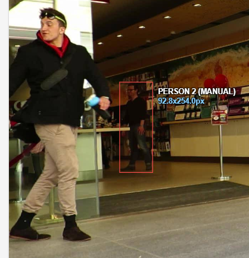
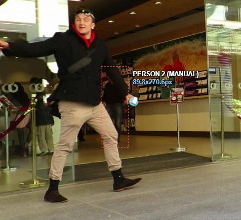

# Báo cáo cá nhân — Bùi Công Đạt — 2A202603068

Đoạn video: MOT17-09, 150 frame (frame 0–149 trên CVAT, frame 1–150 trong `gt.txt`), nguồn MOTChallenge, giấy phép CC BY-NC-SA 3.0.

## 0. Thông tin học viên

- Họ tên: Bùi Công Đạt
- MSSV: 2A202603068
- Mã đề (A/B/C): B (09-B) — P1 = MOT ID 1, P2 = 19, P3 = 20, P4 = 21, P5 = 22 theo `src/lab_variants.json`
- Email: datcongh43@gmail.com
- Link repository: https://github.com/BuiCongDat2905/K5-L2-Day5-2A202603068-BuiCongDat-MOTTracking.git
- Giờ bắt đầu: 16:00 (13/11)
- Giờ kết thúc: 19:30 (13/11)

## 1. Xem trước đoạn video (CP0)

Ghi **trước khi vẽ**, mỗi người một dòng.

| Mã | Frame xuất hiện | Frame cuối thấy được | Rẽ / dừng / đổi tốc độ ở frame | Bị che ở frame | Ghi chú |
|---|---|---|---|---|---|
| P1 | 0 | 149 | đi chậm dần ~20–35; đứng lại trong lúc bị che | `occluded` 25–37 và 53–54; khuất hẳn 38–52 | Người sát cột/người khác che; hiện lại 53, rõ lại 55 — người được chọn cho CP2 |
| P2 | 0 | 149 | rẽ ~9, 31, 39, 69; chậm lại ~30–39 | không | Đi nhanh nhất trong 5 người, lại gần camera nên box to dần |
| P3 | 39 | 149 | rẽ ~43, 52, 86, 129; giảm tốc ~44–50 | không | Vào khung muộn (frame 39), đi nhanh, có lúc box tăng kích thước mạnh |
| P4 | 0 | 144 | gần như đứng yên từ ~31 đến hết | `outside` 110–136 | Đứng gần vạch kẻ, dịch rất ít; khuất 27 frame rồi hiện lại |
| P5 | 1 | 103 | đứng yên từ ~21 | `occluded` 89–103; `outside` từ 104 | Ra khỏi vùng quan sát sau frame 103, không hiện lại |

## 2. Keyframe và thời gian (CP1, CP4)

Số keyframe lấy từ kết quả `src/check_submission.py`.

| Mã | Số keyframe | Keyframe ở frame | Số frame có mặt | Keyframe / 100 frame | Thời gian (phút) | Chỗ khó |
|---|---|---|---|---|---|---|
| P1 | 69 | 0, 9–35 (dày), 53–118 (dày), 120, 130, 140, 144, 149 | 135 | 51.1 | ≈12 | Hai đoạn bị che 25–37 và 53–54; phải đặt lại box toàn thân (amodal) khi bị che một phần |
| P2 | 131 | 0–149 gần như mỗi frame (0, 1, 5, 8–58, 60–120, 122–149) | 150 | 87.3 | ≈14 | Đi nhanh, lại gần camera nên box đổi kích thước liên tục — dễ đặt keyframe quá tay |
| P3 | 48 | 39, 43, 45, 50, 52, 56, 60–61, 64, 68–70, 73–74, 79–80, 86, 89–90, 94, 96–98, 100–101, 103, 110, 113–114, 116, 119–120, 124–125, 128–133, 135–136, 139–141, 144, 148–149 | 111 | 43.2 | ≈10 | Vào khung muộn, đi nhanh và tiến gần camera — nội suy tuyến tính dễ trôi |
| P4 | 9 | 0, 10, 20, 30, 40, 106, 137, 138, 140 | 118 | 7.6 | ≈8 | Gần như đứng yên nên keyframe thưa; khó ở đoạn `outside` 110–136 và lúc hiện lại |
| P5 | 10 | 1, 10, 20, 30, 40, 50, 86, 89, 90, 100 | 103 | 9.7 | ≈8 | Đứng yên rồi bị che 89–103; kết thúc track khi ra khỏi vùng |
| **Tổng** | **267** | | **617** | **43.3** | **≈52** | |

Keyframe / 100 frame của cả bài = 267 ÷ 617 × 100 = **43.3**.

Bạn đặt keyframe nhiều nhất ở người nào? Vì sao (người đó rẽ, dừng, lại gần camera hay bị che)?

P2 (131 keyframe, 87.3/100 frame) — người đi nhanh nhất và lại gần camera nên box thay đổi kích thước mỗi frame; mình đặt keyframe gần như từng frame để box không trôi, dẫn tới quá dày. P1 đứng thứ hai (69 keyframe) vì có hai đoạn bị che phải chỉnh box liên tục.

## 3. Đoạn bị che (CP2)

Người bị che: `P1` (MOT ID 1, track CVAT số 1)

| Mốc | Frame |
|---|---:|
| Bắt đầu bị che một phần (bật `occluded`) | 25 |
| Mất hẳn (bật `outside`) | 38 |
| Hiện lại (tắt `outside`) | 53 |
| Thấy rõ trở lại (tắt `occluded`) | 55 |

- Thời gian khuất hẳn: **15** frame = **0,5** giây.
- Quyết định: **giữ cùng ID** (track 1).
- Lý do (trả lời 3 câu: khuất bao lâu so với 60 frame, ngoại hình có khớp, chỗ hiện lại có đúng hướng và tốc độ):
  1. Khuất 15 frame ≤ 60 frame (2 giây) nên theo quy ước của lớp được giữ cùng ID.
  2. Ngoại hình khớp: cùng áo, quần, dáng người và chiều cao box trước/sau đoạn che.
  3. Chỗ hiện lại đúng hướng đi và tốc độ cũ: người đi chậm, hiện lại lệch vài chục pixel theo đúng chiều di chuyển, không xuất hiện ở phía ngược lại.

Ảnh chụp màn hình:

<br>



## 4. Tự review ID (CP3)

Lượt 1 theo người (đi ngược từ frame 149 về 0 trên CVAT), lượt 2 theo cảnh (nhảy 10 frame). Kết quả: **đã kiểm hai lượt, không phát hiện lỗi ID**. Hai `[CẢNH BÁO]` của script là về **mật độ keyframe** (quá dày ở P1, P2), không phải lỗi ID — đã ghi lý do ở mục 2 và 5.

Loại lỗi dùng đúng một trong 7 mã: `id_switch`, `fragmentation`, `lost`, `merge`, `false_track`, `drift`, `flag`.

| Frame | Mã người | Loại lỗi | Mô tả một câu | Phát hiện ở lượt | Đã sửa? |
|---:|---|---|---|---|---|
| — | P1–P5 | — | Đã kiểm hai lượt (theo người 149→0 và theo cảnh nhảy 10 frame), không thấy `id_switch`, `fragmentation`, `lost`, `merge`, `false_track`, `drift` hay `flag`. | 1 & 2 | — |

Tổng hợp số lỗi theo loại:

| `id_switch` | `fragmentation` | `lost` | `merge` | `false_track` | `drift` | `flag` |
|---:|---:|---:|---:|---:|---:|---:|
| 0 | 0 | 0 | 0 | 0 | 0 | 0 |

Lỗi nào chỉ lượt 2 (theo cảnh) mới thấy, lượt 1 (theo người) không thấy? Vì sao?

Không có lỗi nào. Lượt 1 chỉ nhìn một người nên khó thấy `merge`/`false_track` do hai người đi sát hoặc box bao nhầm người; lượt 2 nhìn cả 5 box trên cùng màn hình nên các lỗi liên quan giữa các track dễ lộ hơn. Lần này cả hai lượt đều sạch.

## 5. File xuất và kết quả tự kiểm (CP4)

| Kiểm tra | Kết quả |
|---|---|
| Tên file MOT 1.1 | `BuiCongDat_mot.zip` |
| Tên file CVAT for video 1.1 | `BuiCongDat_cvat_video.zip` |
| Số track ID khác nhau trong `gt/gt.txt` (phải là 5) | 5 |
| Frame `outside` không có dòng trong `gt.txt` (đúng / sai) | Đúng — P1 khuất frame 38–52, P4 khuất 110–136, P5 khuất sau 103 đều không có dòng trong `gt.txt` |
| Job đã completed trên CVAT máy cá nhân | Có — job `DAY05-MOT17-09-B-2A202603068` đã `completed` |

Dán phần tóm tắt in ra từ `src/check_submission.py`:

```text
Số frame in theo CVAT (bắt đầu từ 0). Trong gt.txt, frame_id = frame CVAT + 1.

=== File MOT 1.1: BuiCongDat_mot.zip ===
  Số track ID: 5   |   Tổng số box: 617
  [OK]        Đúng 5 track ID.

  Track | Frame có mặt | Số frame | Đoạn vắng (outside)
      1 |   0–149      |      150 | -
      2 |   0–149      |      135 | 38–52
      3 |   0–144      |      118 | 110–136
      4 |   1–103      |      103 | -
      5 |  39–149      |      111 | -

=== File CVAT for video 1.1: BuiCongDat_cvat_video.zip ===

  Track | Nhãn   | Frame thấy | Keyframe | KF/100 frame | Frame occluded | Lần bật outside
      0 | person |        150 |      131 |         87.3 |              0 |               0
  [CẢNH BÁO]  Track 0: 87 keyframe / 100 frame > 50. Quá dày, dồn keyframe vào chỗ rẽ / dừng / bị che.
      1 | person |        135 |       69 |         51.1 |             15 |               1
  [CẢNH BÁO]  Track 1: 51 keyframe / 100 frame > 50. Quá dày, dồn keyframe vào chỗ rẽ / dừng / bị che.
      2 | person |        118 |        9 |          7.6 |             12 |               2
      3 | person |        103 |       10 |          9.7 |             15 |               1
      4 | person |        111 |       48 |         43.2 |              0 |               0

  Tổng: 267 keyframe / 617 frame có mặt = 43.3 keyframe / 100 frame
  [OK]        Đọc được 5 track từ annotations.xml.

=== Tóm tắt ===
  Lỗi: 0   |   Cảnh báo: 2
  Không có lỗi định dạng. Mở CVAT xem lại từng [CẢNH BÁO]; cảnh báo đúng ý bạn thì ghi lý do vào báo cáo.
```

## 6. Ba câu kết

1. Nếu được gán lại, bạn sẽ đặt keyframe khác ở đâu? Vì sao?

   Mình sẽ bỏ bớt keyframe ở P2 (đang 131, gần như mỗi frame) và P1 (69), chỉ giữ ở chỗ thật sự đổi hướng, đổi tốc độ hoặc quanh đoạn che: P2 giữ quanh frame 9, 31, 39, 69 (chỗ rẽ/chậm lại) và thêm keyframe ở chỗ box bắt đầu to nhanh khi lại gần camera; P1 giữ quanh 25, 37, 53, 55 (hai đầu đoạn che) và các frame rẽ ~20–35. Nội suy tuyến tính chỉ đúng khi đi thẳng đều, nên keyframe dày đều không giúp box bám tốt hơn mà còn làm box rung.

2. Có chỗ nào bạn không chắc "cùng ID hay ID mới"? Bạn đã quyết định và ghi chú thế nào?

   P1 khuất 15 frame (38–52) — dưới ngưỡng 60 frame, ngoại hình và hướng đi khớp nên mình giữ cùng ID và ghi mốc vào mục 3. P4 khuất 27 frame (110–136), cũng dưới 60 frame, hiện lại đúng chỗ và cùng dáng nên giữ cùng ID. P5 đi ra khỏi vùng quan sát sau frame 103 và không quay lại nên track kết thúc, không cần ID mới.

3. Một lỗi ID trong job của bạn (nếu không còn sót, chọn lỗi đã sửa) có thể làm xe tự lái dự đoán sai chuyển động của người đó như thế nào? Lỗi đó ảnh hưởng MOTA hay IDF1 nhiều hơn?

   Ví dụ nếu một `id_switch` xảy ra khi hai người đi sát nhau: box nhảy từ người này sang người kia trong 1/30 giây, quỹ đạo ghép được sẽ có vận tốc nhảy vọt (đi 1–2 m trong một frame), nên bộ dự đoán chuyển động của xe coi người đó đang lao sang bên và có thể phanh hoặc tránh sai hướng. Lỗi này làm IDSW tăng nên MOTA giảm ít (MOTA = 1 − (FN+FP+IDSW)/GT, mỗi IDSW chỉ là một đơn vị trên tổng GT), nhưng IDF1 giảm mạnh hơn vì IDF1 ghép cả track với cả track: một người bị tách sang hai ID thì phần lớn frame của họ bị tính là IDFN/IDFP.

## Bonus (nếu làm)

Chưa làm bonus. Nếu làm: xem hướng dẫn trong `CHECKPOINTS.md` mục Bonus (B1 cần coach chỉ định 2 người đi sát; B2 so hai cách đặt keyframe; B3 so với tracker có sẵn).

## 7. Tài liệu tham khảo và công cụ AI đã dùng
- Công cụ AI: DeepSeek Harness — Hỗ trợ làm báo cáo.